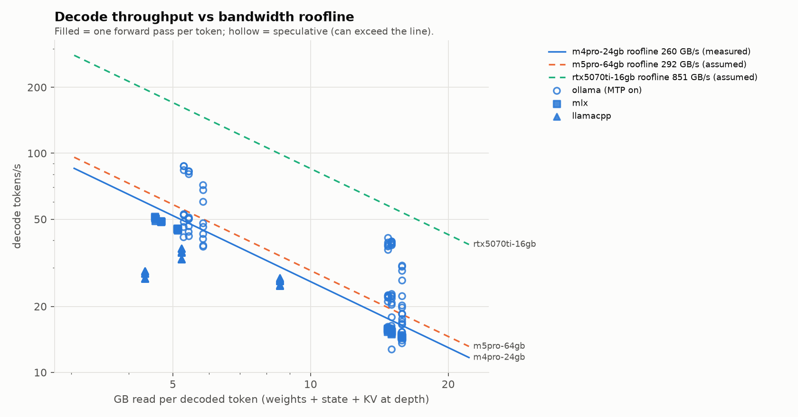
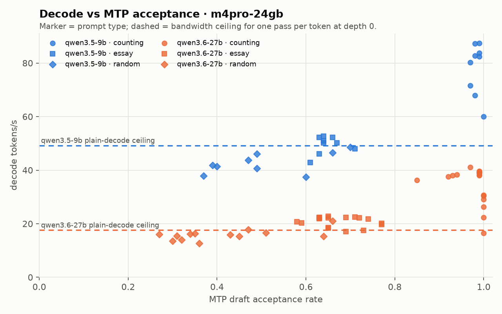

# LLM inference roofline study

How close does local LLM decode get to the memory-bandwidth limit, and what do
speculative decoding and context depth do to that? The same suite runs on every machine
and the results go side by side.

```
decode t/s ceiling  ≈  bandwidth / bytes read per token
bytes read per token =  weights read per step + recurrent state + KV cache × depth
```

| machine | slug | nominal BW | status |
|---|---|---|---|
| MacBook Pro M4 Pro 12C CPU / 16C GPU, 24 GB | `m4pro-24gb` | 273 GB/s (260 measured) | active |
| MacBook Pro M5 Pro, 64 GB | `m5pro-64gb` | 307 GB/s | arrives 2026-11-20 |
| Desktop RTX 5070 Ti, 16 GB | `rtx5070ti-16gb` | 896 GB/s | later |

New to rooflines? [`learning.md`](learning.md) walks through arithmetic intensity, the ridge
point, and why batch-1 decode is memory bound, using this machine's numbers.

## Quick start
```sh
uv sync --extra mlx            # Python env; drop --extra mlx on non-Apple machines
uv run pytest                  # offline tests, ~1 s
uv run suite.py check          # runtimes, models, machine slug
uv run suite.py fetch          # pull/download configured models that are missing
uv run suite.py run --quick    # 1-rep smoke test of every runtime -> results/_smoke/
uv run suite.py all            # models -> membw -> predict -> full sweeps -> plots
```
Steps can be run one at a time: `models`, `membw`, `predict`, `run [-r ollama mlx llamacpp]`, `plots`.
The matrix and model list live in `config/suite.toml`.

Requirements: [uv](https://docs.astral.sh/uv/), Ollama, `brew install llama.cpp` for `llama-bench`.
Only light dependencies: the stdlib, plus matplotlib, `gguf`, and mlx-lm on Apple.

## Layout
Each directory has an `info.md` with the details.
```
suite.py            orchestrator (reads config/, drives bench/ and tools/)
predict.py          roofline ceilings per machine x model x depth, written before runs
plots.py            figures + summary table from all results
bench/              runners: ollama_bench.py, mlx_bench.py, llamacpp_bench.sh, membw.py; shared schema/prompts/env
tools/              model_bytes.py: bytes read per token, from the actual tensor files
config/             suite.toml (matrix + models), machines.json, models.json (generated)
tests/              offline pytest suite: log parsing, byte accounting, ceilings, schema, plots
results/<machine>/  CSVs + env.json per run, membw.json, predictions.csv, info.md
results/plots/      roofline.png, depth_<machine>.png, mtp_<machine>.png, summary.csv
```

## Method
1. **Bytes per token come from the tensor files** (`tools/model_bytes.py`), not params × bits.
   Decode reads the transformer layers, lm_head and final norm. It doesn't read the
   embedding table (one row only), the vision tower, or (outside speculation) the MTP head.
2. **Bandwidth is measured** (`bench/membw.py`, MLX read kernel, best of 30 over 2 GiB).
   Machines not measured yet use nominal × 0.95.
3. **Predictions are written before runs** (`predict.py` -> `results/<machine>/predictions.csv`).
4. **Three runtimes, the same prompts:**
   - Ollama: MLX runner, MTP speculation always on. Per-request acceptance comes from `server.log`.
   - mlx-lm: same GPU stack, no draft model. This is the speculation-off control.
   - llama.cpp: `llama-bench` on GGUF. A separate engine; several quants of one model sweep bytes/token.
5. **Matrix:** model × prompt type (counting / essay / random) × context depth × reps.
   Every Ollama request is cache-busted, `think=false`, and run on a freshly loaded,
   warmed model (see the traps in `bench/info.md`).

## Findings (M4 Pro, 24 GB)
Full sweep, 2026-10-31: 3 reps per cell, 512 tokens per run (llama.cpp: pp512 + tg128,
5 reps). Measured bandwidth **259.5 GB/s** (95% of 273 nominal), High Power mode on a
60 W supply. Per-cell medians are in [`results/plots/summary.csv`](results/plots/summary.csv);
the raw rows are in [`results/m4pro-24gb/`](results/m4pro-24gb/).



### 1. Plain decode lands at ~89% of the bandwidth roofline, at every depth
mlx-lm with no draft model (the speculation-off control):

| model | bytes/token (depth 0) | ceiling | measured | efficiency |
|---|---|---|---|---|
| Qwen3.5-9B 4-bit | 4.57 GB | 56.7 t/s | 50.4 t/s | 0.89 |
| Qwen3.6-27B 4-bit | 14.72 GB | 17.6 t/s | 15.6 t/s | 0.89 |

Efficiency stays between **0.885 and 0.899 in every cell**: both models, all three prompt types,
and depths 0, 4k and 16k. The byte model (weights + recurrent state + KV × depth) predicts
the depth effect, not just the depth-0 point. Content makes no difference without speculation.

### 2. Depth costs about what reading the KV cache costs
The 9B's 8 full-attention layers hold 32 KB of KV per context token, which predicts
**0.126 ms per 1k tokens** at 259.5 GB/s. Measured per-token slowdown, depth 0 → 16k:
MLX **0.149 ms/1k**, Ollama essay **0.157 ms/1k**. The ~0.33 ms/1k from the earlier manual
runs did not reproduce. Counting looks steeper on Ollama only because tokens/pass falls
with depth (5.33 → 4.06), not because each pass costs more.

### 3. MTP speculation: a big win on predictable text, break-even on unpredictable
Ollama (MTP always on), against each model's plain-decode ceiling:

| | counting | essay | random |
|---|---|---|---|
| 9B decode (ceiling 49.1) | **87.3 t/s** (1.78×) | 52.3 (1.07×) | 46.1 (0.94×) |
| 27B decode (ceiling 17.6) | **39.1 t/s** (2.23×) | 22.3 (1.27×) | 16.1 (0.92×) |
| tokens per pass (9B / 27B) | 5.33 / 5.33 | 1.67 / 1.96 | 1.35 / 1.23 |

- Tokens per pass ≈ accepted drafts + 1. Every accepted draft has been verified by the full
  model, so output is unchanged; one full weight read is just shared across more tokens.
- On random text speculation roughly **breaks even**. 0.92–0.94 of the ceiling vs ~0.89
  for plain decode: no gain, but no real loss.
- The 27B gains more than the 9B (2.23× vs 1.78× on counting). Its draft head is a smaller
  share of what each pass reads (0.85 / 14.5 GB vs 0.49 / 5.2 GB).



### 4. Smaller quants hit the compute roof (llama.cpp)
| Qwen3.5-9B GGUF | bytes/token | ceiling | decode | efficiency |
|---|---|---|---|---|
| Q8_0 | 8.54 GB | 30.4 t/s | 26.7 t/s | 0.88 |
| Q4_K_M | 5.20 GB | 49.9 t/s | 36.8 t/s | 0.74 |
| Q3_K_M | 4.33 GB | 60.0 t/s | **29.1 t/s** | 0.48 |

Q3_K_M reads 17% fewer bytes than Q4_K_M but decodes **21% slower**. Unpacking 3-bit
K-quants costs enough GPU arithmetic per byte that decode is no longer purely bandwidth
bound. Q8_0's simple dequantization matches MLX's ~88%.

### 5. Power and heat move prefill, not decode
- **Low charge on a 60 W supply limits compute.** The first Ollama 27B runs, at 31–33% battery,
  prefilled at **62–68 t/s** at 4k context. From ~35% charge onward, 4k prefill sat at
  **92–107 t/s**, the same as in a rerun at 80–89% (median 97.6). Above ~35% the charge
  level made no difference.
- **16k prefill got slower at high charge** (median 84.8 → 71.1 t/s), so charge level
  can't explain it. That rerun followed ~3 hours of continuous load, and a 16k prefill is
  ~4 minutes of solid compute, so thermals are the likely cause. Not yet confirmed (open question).
- **Decode held steady through all of it** (27B essay 17.5–22.3 t/s in both runs). Decode
  is bandwidth bound; prefill is compute bound, so it is what power and heat affect.
- **The MLX 27B (20.5 GB peak) draws more than 60 W:** the battery fell 44% → 34% during its
  stage, and the drain guard stopped it 2 cells early. The 9B and Ollama's 27B charged the
  battery throughout.
- Earlier attempts on battery and on a 30 W charger throttled decode by up to ~40% and were
  discarded. Hence the power guards in `suite.py` (see `bench/info.md`).
- **24 GB is tight for a 27B at 16k context.** During the rerun, Ollama held 19.1 GB and the
  system dropped to 8% free memory. Close other apps for 27B sweeps.

### Methodology traps found along the way
- **Ollama's MTP draft depth persists across requests.** One low-acceptance request left the
  next starting at depth 0 (2.9 → 1.46 tokens/pass on the same prompt). Every run now gets a
  fresh, warmed runner.
- **Context filler can leak into the task.** English-word filler let `random` copy from its own
  context (acceptance 0.9 at 16k). Filler is now pronounceable non-words.
- **Lazy page-in after reload** inflated 27B prefill (5 t/s instead of 90) until a 1-token warm-up was added.

### From the earlier manual runs (before the suite)
- Ollama runs qwen3.5:9b and qwen3.6:27b (NVFP4) through its MLX runner, not llama.cpp.
- MTP is always on: `draft_num_predict=0` (API option or Modelfile) does **not** disable it.
- Ollama's `eval_duration` matches wall clock to within ~1%.
- A speculative pass costs ~2–2.6× a plain one (52 ms vs ~20 ms on the 9B).

## Adding a machine or model
See `config/info.md`. In short: add the machine to `config/machines.json` (key = the slug
`suite.py check` prints), add models as `[[model]]` blocks in `config/suite.toml`, then `uv run suite.py all`.
